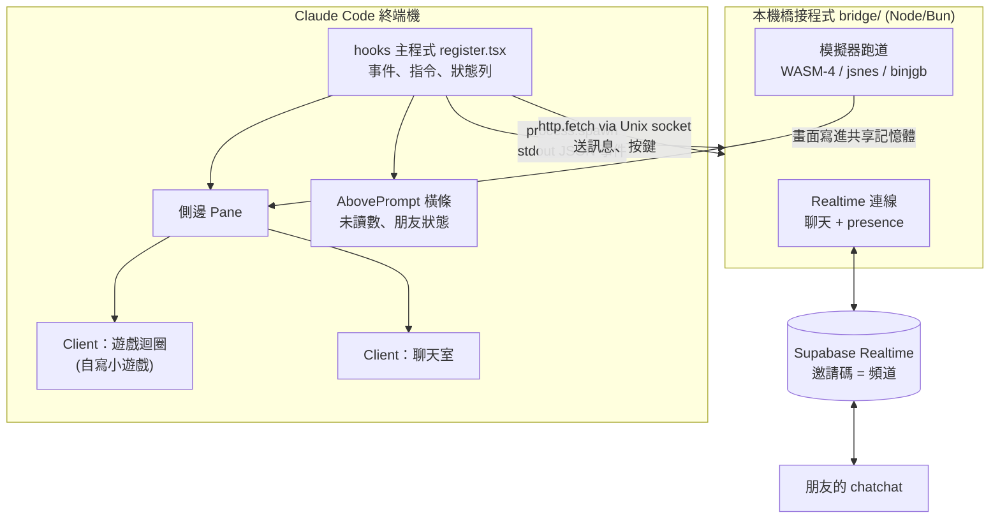
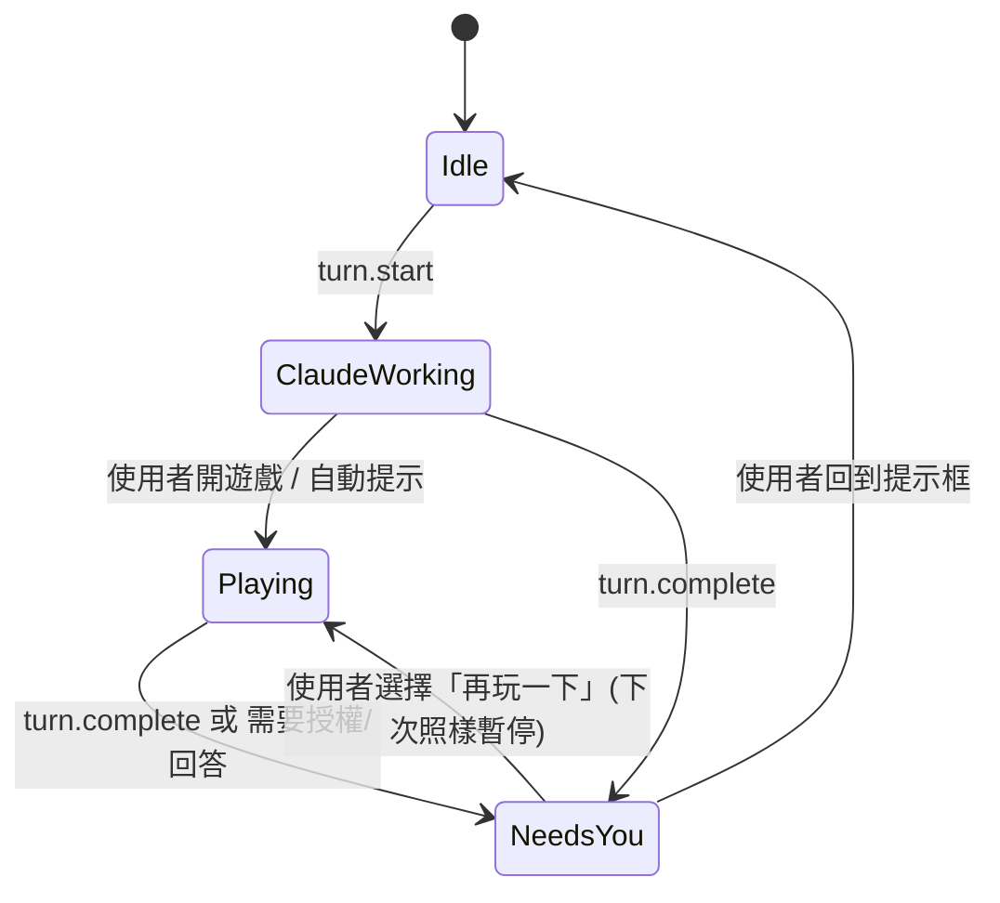
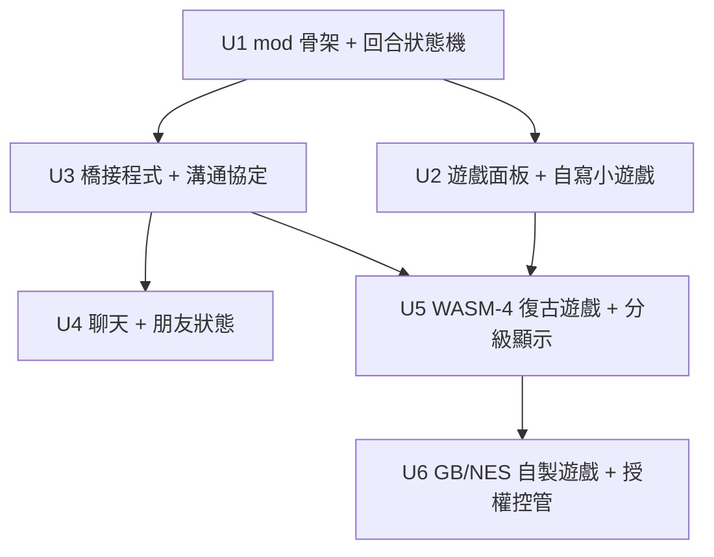

# feat: chatchat — 一邊寫 code、一邊聊天、一邊玩小遊戲的 Claude Code mod

## Overview

做一個 Claude Code mod（Claude Code 的外掛，可以在終端機裡加面板、橫條、狀態列和指令），讓使用者在 Claude 工作的空檔做兩件事：

1. **玩小遊戲**：先做自寫的小遊戲，再加上「復古主機風」的遊戲。
2. **跟朋友聊天**：輸入邀請碼就能加入同一個聊天室，也能看到誰正在等 Claude。

Claude 一做完或停下來問問題，遊戲就暫停並提醒你回來。

**白話結論**：技術上做得到，市面上也已經有人做過「遊戲」這一半（cc-arcade）。我們真正的差異是**聊天**和**合法的復古遊戲**。任天堂沒有開源任何遊戲，所以「任天堂小遊戲」只能透過三種方式實現：開源模擬器加上授權明確的自製遊戲、開源幻想主機（WASM-4），或者自己寫。

## Problem Frame

使用 Claude Code 時，常常要等幾十秒到幾分鐘。這段時間大家會切去滑手機或開 Discord，結果錯過 Claude 的提問，注意力也斷掉。我們的目標是把「等待時間」留在終端機裡，同時保證不會因此錯過 Claude 的回覆。

## Requirements Trace

- R1. 在 Claude Code 裡（不另開視窗）玩至少 3 款小遊戲，鍵盤直接操作。
- R2. Claude 一回合結束、或需要使用者回答／授權時，遊戲自動暫停並提醒（toast、聲音、狀態列）。
- R3. 能用邀請碼跟朋友進同一個聊天室，即時收發訊息，並看到對方的狀態（在線上、等 Claude 中、專注中）。
- R4. 朋友的訊息**預設不會**進入 Claude 的上下文，避免有人透過聊天訊息操控 AI（prompt injection）。
- R5. 「任天堂風」的遊戲只能使用授權可以再散布的內容，不碰商業 ROM，也不在產品名稱裡用任天堂商標。
- R6. 畫面會依終端機能力自動降級：kitty 圖片協定（Kitty／Ghostty 支援的高畫質圖片）→ 半格字元彩色 → 純文字。
- R7. 不拖慢正常的寫 code 流程。mod 沒開啟時不會常駐耗資源。
- R8. 目標使用者包含設計師。提供 3 套可切換主題（Studio 預設、Riso、Pocket），三套只換外觀，流程和按鍵完全一樣。
- R9. 內建 statusline，讓沒有自己 statusline 的朋友也能用：資料夾、分支、模型、本次花費、今日累計、5 小時額度。可以切換顯示或隱藏，每個段落也能單獨開關；偵測到使用者已有自己的 statusLine 時不重複顯示。

## Scope Boundaries

- 不做：商業任天堂 ROM、「自備 ROM」（BYO ROM）功能、Switch／3DS 模擬（v1）。
- 不做：把朋友拉進同一個 Claude session 一起操作 AI（「多人共用 Claude」是另一個題目）。
- 不做：語音、視訊、檔案傳送。
- 不做：桌面版、VS Code、手機介面的完整支援。v1 只保證終端機（terminal surface）。
- 不做：排行榜、帳號系統。v1 用邀請碼加暱稱就好。

## Context & Research

### Relevant Code and Patterns

- Repo 目前是空的（`chatchat` 剛初始化），沒有既有程式碼可以參考。
- Claude Code mod API（本機 build 2.1.287 的型別檔 `claude-code.d.ts`）中確認可用的能力：
  - 面板：`$.ui.open` 開一個 Pane，用 `ui.render` 畫內容。
  - 提示框上方的橫條：`AbovePrompt`。
  - 狀態列與提示：`$.ui.status`、`$.ui.toast`。
  - 聲音：`$.audio.play`。
  - 斜線指令：`$.command.register`。
  - 遊戲迴圈：`Client` 元件是 mod 自己的畫面模組，有獨立狀態和計時器，能直接收 `onKey`（鍵盤）和滑鼠事件。
  - 像素畫面：`Raster` 是終端機格子畫布（最大 512×256 格），可以用 `$.ui.blit` 依畫面更新率重畫。`Image` 能讀「另一個本機程式寫出來的檔案或共享記憶體」，在 kitty 協定下顯示真正的圖片。
  - 網路：只有 `$.http.fetch`（一次性 HTTP），**沒有 WebSocket**。
  - 子程式：`$.process.spawn` 能啟動一個長期跑的子程式，並逐段讀取它的輸出。它的生命週期跟著 mod。
  - 回合事件：`turn.start` 和 `turn.complete`。
  - 狀態保存：`$.state`（本次 session）和 `$.store`（跨 session）。

### Institutional Learnings

- 沒有 `docs/solutions/`，因為是新 repo。
- 使用者記憶裡有一筆：在外層 umbrella 用 EnterWorktree 會建到錯的 repo。這個 repo 已經改成獨立 git repo 並修正。

### External References（前例，當作 idea 來源）

| 專案 | 做了什麼 | 我們借什麼 |
|---|---|---|
| [cc-arcade](https://github.com/sezaakgun/cc-arcade)（MIT） | Claude Code mod，`/arcade` 在提示框上方開 9 款遊戲；回合結束自動暫停；有一隻會隨測試和 commit 長大的寵物 | 最接近的前例：暫停時機、把工具事件當成遊戲獎勵 |
| [claude-snake](https://github.com/ebubekir/claude-snake)（MIT） | 純 Bash 貪食蛇，靠 hooks 在另一個 pane 開關 | 不用 mod API 也能做的退路 |
| [claude-arcade](https://github.com/anshuman-dev/claude-arcade) | 每次工具執行時自動開遊戲 | 自動開、自動收 |
| [pi-nes](https://github.com/tmustier/pi-nes)（MIT） | 在 Pi coding agent 裡跑 NES 模擬器，用 kitty 圖片顯示，不附 ROM | 「等 agent 時玩 NES」的可行性證明 |
| [claude-code-discord-status](https://github.com/BrunoJurkovic/claude-code-discord-status)（MIT）、[claude-rpc](https://github.com/rar-file/claude-rpc) | 把 hook 事件轉成 Discord 上的狀態顯示 | 「朋友現在在等 Claude」的狀態對照 |
| Reddit「Claude Code multiplayer server」 | 用邀請碼加事件串流讓多人共看 | 邀請碼加中繼伺服器（relay）的模式 |
| [Claude Code Channels](https://code.claude.com/docs/en/channels) | 官方把外部訊息推進 session 的機制 | v2 的選項，可以「把某則訊息交給 Claude」 |
| [doom-cli](https://github.com/ludocode/doom-cli)、[kitty graphics protocol](https://sw.kovidgoyal.net/kitty/graphics-protocol/) | 在終端機顯示遊戲畫面 | 分級降級的顯示方式 |
| [WASM-4](https://wasm4.org/)（ISC） | 160×160、4 色的開源幻想主機，每個遊戲是一個小 `.wasm` 檔 | 最適合終端機的「復古主機」 |
| [jsnes](https://github.com/bfirsh/jsnes)（Apache-2.0）、[binjgb](https://github.com/binji/binjgb)（MIT） | NES、Game Boy 模擬器核心 | 搭配合法的自製 ROM |
| [Homebrew Hub](https://hh.gbdev.io/) | GB／GBC／GBA 自製遊戲資料庫，每款遊戲各有授權 | 合法的 ROM 來源（要逐款確認授權） |

法律背景：2024 年 Yuzu 案以 240 萬美元和解，案由是破解加密（DMCA 反規避條款），不是「模擬器違法」。同年 Ryujinx 在任天堂接觸後停止開發。法院先例（Sony v. Connectix）認為**寫模擬器本身合法，散布 ROM 違法**。以上不構成法律意見，商業上架前要找律師確認。

## Key Technical Decisions

| 決策 | 選擇 | 白話理由 | 放棄的選項 |
|---|---|---|---|
| 主體形式 | Claude Code mod（function hooks）：側邊 Pane 加提示框上方橫條加狀態列 | 不用切視窗，又能拿到「Claude 開始／結束」的事件 | 另開 tmux pane（claude-snake 的做法）：只留作退路 |
| 遊戲迴圈放哪 | 放在 `Client` 畫面模組裡（本機計時器加 `onKey`） | 按鍵到畫面不用繞回主程式，延遲最低 | 在 hooks 主程式用 `ui.render` 重畫：每一格都要整棵重畫，太慢 |
| 即時連線 | 由 mod 用 `$.process.spawn` 啟動一個本機「橋接程式」（`bridge/`，Node 或 Bun），WebSocket 和模擬器都在它裡面跑 | mod 本身沒有 WebSocket，也不確定能不能跑 WASM；橋接程式是一般 Node 程式，什麼都能做 | 用 `$.http.fetch` 輪詢：耗流量、延遲高 |
| mod 跟橋接程式怎麼溝通 | 橋接程式從 stdout 輸出一行一個 JSON 事件給 mod；mod 透過 Unix socket 用 `$.http.fetch({ socketPath })` 下指令 | 兩個方向都用 API 本來就支援的管道 | 自訂二進位協定：沒必要 |
| 聊天中繼 | Supabase Realtime 頻道（broadcast 加 presence），一組邀請碼對應一個頻道 | 你本來就熟 Supabase，免架伺服器，presence（誰在線上）是內建功能 | Discord bot（要每個朋友授權、受服務條款限制）、Matrix（太重）、自架 WebSocket（要維運） |
| 聊天跟 Claude 的關係 | 朋友的訊息**只顯示給人看**，不進 Claude 的上下文。v2 才加「把這則訊息交給 Claude」的明確按鈕 | 防止朋友（或冒充的人）在聊天裡塞指令操控你的 AI | 自動餵給 Claude（Channels）：風險太高 |
| 遊戲分層 | 第 1 層：自寫 TS 小遊戲。第 2 層：WASM-4 卡帶。第 3 層：jsnes／binjgb 加授權明確的自製 ROM | 由易到難，每一層都能單獨上線 | 先做 NES 模擬器：最難也最有法律風險 |
| 復古畫面怎麼顯示 | 橋接程式把畫面寫到共享記憶體或檔案；終端機支援 kitty 就用 `Image`，不支援就降成 `Raster` 半格字元（1 格 = 上下 2 像素） | `Image` 原生支援「另一個程式寫的共享記憶體」，像素不用經過 mod | 全部轉成 ASCII：畫質太差 |
| 授權控管 | `games/catalog.json` 記錄每款遊戲的來源、授權、署名；CI 檢查「沒有授權欄位就不能上架」 | 把法律風險變成一個可以檢查的步驟 | 憑記憶判斷 |
| 命名 | 產品名用 `chatchat`，遊戲名不用 Tetris、Mario、Nintendo（例如「方塊落」） | 避開商標和 trade dress（外觀）糾紛 | 用原名吸引人：風險高 |
| 主題 | 一份「語意 token」對照表（面板底、強調、做完了、要授權、朋友色、訊息樣式、做完的呈現、提示音），三套主題各填一份；畫面元件只讀 token | 換主題不用改流程，測試寫一次就能套到三套主題；設計師要加第四套也只是新增一份檔案 | 每套主題各寫一份畫面：會變成三份要分別維護 |
| 字型 | 不換字型，設計感靠配色、字元大字、像素插圖和版面 | mod API 沒有字型屬性，終端機永遠用使用者自己的字型 | 無 |
| 內建 statusline | 用 `$.ui.status` 固定一行。數字來源：`$.session.usage()`（花費、5 小時額度、context）、`$.process.run`（git 分支、bun 版本）、`$.store`（今日累計帳本） | 不需要 bash、jq，Windows 也能用；chatchat 自己的資訊可以合併在同一行 | 直接打包使用者的 bash 腳本：朋友的電腦不一定有 bash 和 jq |
| statusline 跟使用者原本的設定並存 | 三種模式：自動（偵測到已有 statusLine 就只顯示 chatchat 段）、完整、關閉 | mod 的狀態行和 settings 裡的 statusLine 是兩行並存，不是取代 | 強制取代：不允許，也不禮貌 |
| 跟 cc-arcade 的關係 | 參考它的設計（MIT），遊戲本身自己寫；之後考慮相容或貢獻回去 | 避免重複造輪子，又保留我們的聊天特色 | 直接 fork：會被綁在它的架構上 |

## Open Questions

### Resolved During Planning

- mod 能不能收鍵盤和顯示像素？可以，用 `Client.onKey` 加 `Raster`／`Image` 加 `$.ui.blit`。
- mod 能不能開 WebSocket？不能，所以改用橋接程式。
- 任天堂有沒有開源遊戲？沒有，改走模擬器加合法自製遊戲，或 WASM-4。
- 有沒有人做過？遊戲部分有（cc-arcade、pi-nes），聊天部分還沒人做進 Claude Code。

### Deferred to Implementation

- mod 的執行環境能不能直接跑 `WebAssembly`？如果可以，WASM-4 就能搬進 mod，少一個程式。這要實際載入才知道。
- `Client` 的實際畫面更新率上限，以及 `Raster` 在 80×40 格時會不會閃爍。要實測。
- 側邊 Pane 寬度只有約 60 到 80 欄，160×160 的 WASM-4 畫面需要縮成一半（80×40 格半格字元），可讀性要實測。
- 在 tmux 裡 kitty 圖片會被擋掉，偵測方式要實測。
- Supabase 匿名登入加 Realtime 的頻道授權（RLS 權限規則）細節，要對照最新文件（用 Context7 查）。
- 自動模式要偵測使用者「已經有 statusLine」：mod API 能不能讀到 settings 的 `statusLine` 欄位，要在實作時查型別檔（`$.settings`）。讀不到的話，改成第一次啟動時問使用者一次。
- 開放的產品問題（建議先跑 `/superpowers:brainstorming`）：只是自己和固定幾個朋友用，還是要上架 claudemods.ai？這會影響要不要做帳號和檢舉功能。

## High-Level Technical Design

> *以下是方向示意，給審查時確認方向用，不是實作規格。實作時當成參考背景，不要照抄成程式碼。*

回合狀態機（決定遊戲什麼時候暫停、什麼時候提醒）：

## UX Flow

畫面稿（14 張，Design 畫布）：https://claude.ai/artifact/Ge2SY1gbfKwWrDqLPyQpGQ

- **四個顯示位置的分工**：
  - 狀態列：永遠在，只顯示狀態。
  - 提示框上方橫條：輕提示，不搶鍵盤。
  - 側邊面板：使用者主動開才出現，有「遊戲／聊天／朋友」三個分頁。
  - toast 加提示音：只用在 Claude 做完或要授權，聊天訊息永遠不用。
- **流程 A（遊戲）**：
  - 使用者送出指令約 5 秒後，橫條出現 `[g] 玩一下 / [c] 聊天 / [x] 這次不用`。
  - 按 `g` 開面板 → 進入遊戲。
  - Claude 做完時遊戲凍結，出現 `Enter 回去 / z 再玩 30 秒`。「再玩」只延這一次。
  - Claude 要授權時沒有「再玩」，鍵盤直接交回授權選單。
- **流程 B（聊天）**：
  - `/chatchat invite [名稱]` → 拿到邀請碼（24 小時有效，可以 revoke 作廢）。
  - 朋友 `/chatchat join <碼>` → 第一次輸入暱稱 → 進入聊天室。
  - 聊天分頁上方顯示朋友狀態，頂端固定一行「訊息不會傳給 Claude」。
  - 面板關著時，新訊息只讓橫條顯示未讀數，不跳面板、不發出聲音。
- **邊界狀況**：
  - 終端機不到 144 欄：不自動開面板；手動開的話面板佔滿下半部。
  - 斷線：顯示黃條，自動重試，按 `r` 立即重試。
  - 缺少 Node/Bun：清楚說明要裝什麼，自寫小遊戲照常可以玩。
  - 勿擾模式：不出現任何邀玩或聊天提示，但 Claude 做完照樣提醒。
  - 隱私：朋友預設只看得到狀態，看不到專案名稱或分支。
- **按鍵**：`g` 遊戲、`c` 聊天、`Esc` 回提示框（遊戲自動暫停）、`Tab` 換分頁、`Enter` 做完時回去、`z` 再玩 30 秒、`r` 重試。
  - 實作時要確認 `g`、`c` 這兩個熱鍵不會跟使用者在提示框打字衝突。依 mod API，按鈕熱鍵只在「焦點在橫條或面板」時生效（從提示框按 ctrl+x tab 移過去），所以在提示框直接按 `g` 會變成打字。這點要在 U1 實測，再決定是否改成組合鍵。

## Implementation Units

### Phase 1：單人版（可以先發給自己用）

- [ ] **U1：mod 骨架與回合狀態機**

**Goal:** mod 能載入，有 `/chatchat` 指令，狀態列顯示「Claude 工作中 0:42」，回合結束時發出 toast 和聲音。

**Requirements:** R2, R7

**Dependencies:** 無

**Files:**
- Create: `mod/.claude-plugin/plugin.json`, `mod/hooks/hooks.json`, `mod/hooks/register.tsx`, `mod/hooks/lifecycle.ts`, `mod/types/index.d.ts`
- Test: `mod/hooks/lifecycle.test.ts`

**Approach:**
- `turn.start` 和 `turn.complete` 驅動上面的狀態機。狀態存在 `$.state`，所以 hot reload 後不會遺失。
- 「需要你」的觸發條件包括 `turn.complete`，以及工具呼叫在等授權的時候（實作時查型別檔裡相關事件的名稱）。
- 設定（自動開遊戲、聲音開關）放在 `userConfig`。

**Patterns to follow:** plugin-authoring skill 的 `examples/band.tsx`、`examples/tool-call.ts`；cc-arcade 的暫停邏輯。

**Test scenarios:**
- Happy path：`turn.start` 之後狀態是 ClaudeWorking，狀態列有計時；`turn.complete` 之後變成 NeedsYou，並發出一次 toast。
- Edge case：連續兩次 `turn.complete` 只提醒一次；使用者中斷（abort）回合時不發「完成」提醒。
- Edge case：聲音設定關閉時不呼叫 `$.audio.play`。
- Integration：mod hot reload 後，`$.state` 裡的狀態仍然保留。

**Verification:** `claude plugin validate mod` 和 `claude plugin test mod` 都通過；實際跑一個回合時，看得到狀態列和 toast。

- [ ] **U2：遊戲面板加三款自寫小遊戲**

**Goal:** `/chatchat play` 開側邊 Pane。裡面有選單和三款遊戲：貪食蛇、2048、踩地雷。遊戲會依狀態機暫停。

**Requirements:** R1, R2

**Dependencies:** U1

**Files:**
- Create: `mod/hooks/arcade/ArcadeClient.tsx`（Client 畫面模組）, `mod/hooks/arcade/games/snake.ts`, `mod/hooks/arcade/games/merge2048.ts`, `mod/hooks/arcade/games/mines.ts`, `mod/hooks/arcade/engine.ts`
- Test: `mod/hooks/arcade/games/*.test.ts`, `mod/hooks/arcade/arcade.test.ts`

**Approach:**
- 遊戲邏輯寫成純函式，像 `step(state, input) -> state` 這樣，跟畫面分開，方便測試。
- `Client` 只負責計時器、按鍵和用文字格子畫圖。
- hooks 主程式透過 Client 的 `props` 傳入 `paused` 旗標。最高分存在 `$.store`。
- Pane 是使用者主動開的，所以任何寬度都能開。自動開的 Pane 需要至少 144 欄，所以「自動開」預設只顯示 toast 提示，不硬開 Pane。

**Patterns to follow:** `examples/pane.tsx`；cc-arcade 的遊戲清單。

**Test scenarios:**
- Happy path：貪食蛇吃到食物後長度加 1、分數加分；2048 合併 2+2 得到 4。
- Edge case：貪食蛇撞牆或撞到自己算 game over；2048 盤面滿了又不能合併算 game over；踩地雷第一下絕對不會踩到雷。
- Edge case：`paused=true` 時計時器不推進遊戲狀態；取消暫停後從原處繼續。
- Integration：mount ArcadeClient，按方向鍵後畫面裡的蛇位置改變。這個測試要在 `terminal` 和 `desktop` 兩種 surface 各跑一次。

**Verification:** 一邊讓 Claude 跑長任務一邊玩，Claude 做完時遊戲會停下來並提醒。

- [ ] **U2b：主題系統（Studio／Riso／Pocket）**

**Goal:** 所有 chatchat 畫面改成從主題 token 取色、取字元、取提示音；用 `/chatchat theme` 切換，並記住使用者的選擇。

**Requirements:** R8

**Dependencies:** U1、U2

**Files:**
- Create: `mod/hooks/theme/tokens.ts`, `mod/hooks/theme/studio.ts`, `mod/hooks/theme/riso.ts`, `mod/hooks/theme/pocket.ts`, `mod/hooks/theme/ThemePicker.tsx`, `mod/assets/sounds/`
- Modify: `mod/hooks/arcade/ArcadeClient.tsx`、橫條、toast 的呼叫處
- Test: `mod/hooks/theme/theme.test.ts`

**Approach:**
- token 只描述「角色」，例如 `surface`、`accent`、`attention`、`danger`、`friend[0..3]`、`doneStyle`、`chatStyle`、`sound.done`，不寫死顏色。
- Riso 是亮色紙張底，深色終端機也會顯示成一塊亮色區域，這是刻意的設計。另外提供「終端機是淺色時預設用 Riso」的選項。
- Pocket 只有四階綠，朋友改用 1P／2P／3P 圖示區分，不靠顏色。
- 每套主題的朋友顏色除了色相，明暗也要拉開，讓色弱使用者也分得出來。

**Patterns to follow:** 畫布上的「主題系統」和「切換主題」兩張畫板。

**Test scenarios:**
- Happy path：切換到 Riso 後，畫面元件拿到 Riso 的 token；重新載入後仍然是 Riso。
- Edge case：設定裡的主題名稱不存在（例如舊版留下的值）時退回 Studio。
- Integration：同一個「做完了」事件，在三套主題下都會觸發暫停和提醒，只有外觀不同。這個測試跑三次，每套主題一次。
- Accessibility：每套主題的文字與背景對比度至少 4.5:1（用 token 自動檢查）。

**Verification:** 三套主題各跑一次流程 A，行為一致。

- [ ] **U2c：內建 statusline（可切換）**

**Goal:** `/chatchat statusline` 切換「自動／完整／關閉」三種模式，並可以單獨開關每個段落。

**Requirements:** R9

**Dependencies:** U1（chatchat 段來自 U1 的狀態機）

**Files:**
- Create: `mod/hooks/statusline/segments.ts`, `mod/hooks/statusline/ledger.ts`, `mod/hooks/statusline/render.ts`
- Test: `mod/hooks/statusline/statusline.test.ts`

**Approach:**
- 段落和使用者原本的 `statusline-cost.sh` 對齊：📁 資料夾 | ⚡ bun 版本 | 🌿 分支（有未提交改動加 *） | 🤖 模型 | 💸 本次花費 | 💰 今日累計 | ⏰ 5 小時額度剩餘（用掉 70% 變黃、90% 變紅），最後接上 ◆ chatchat 段。
- 資料來源：
  - 花費、額度：`$.session.usage()`，數字跟 statusline 看到的一樣；
  - 分支和是否有未提交改動：`$.process.run` 執行 git，並做節流，最多每幾秒一次；
  - bun 版本：啟動時查一次；
  - 今日累計：`$.store` 裡以日期為 key、每個 session 一筆的帳本，在 `turn.complete` 時更新，自動清掉 7 天以前的資料。
- 更新時機：`turn.start`、`turn.complete`、工具呼叫結束、每 30 秒一次。不要每秒跑 git。
- 自動模式：能讀到使用者的 statusLine 設定時，只顯示 chatchat 段。
- 隱私：statusline 只在自己的畫面顯示。花費、分支這些資訊**不**透過聊天的線上狀態廣播出去。
- 段落圖示預設用 emoji（跟使用者原本的一樣），主題可以換成字元版。

**Test scenarios:**
- Happy path：mock `$.session.usage()` 回傳 `cost=0.84`、5 小時額度用掉 50%，輸出包含「💸 $0.84」和剩餘時間。
- Edge case：不在 git repo 裡就不顯示分支段；沒裝 bun 就不顯示 bun 段；拿不到額度資料就不顯示 ⏰ 段。不會出現空白的分隔線。
- Edge case：額度用掉 72% 時剩餘時間變黃，95% 時變紅。
- Edge case：跨過午夜後，今日累計從 0 重新開始；同一個 session 更新多次只算一筆，不會重複加總。
- Edge case：模式切到「關閉」時呼叫 `$.ui.status(undefined)` 清掉狀態行；所有段落都關掉時也一樣。
- Integration：自動模式下偵測到使用者已有 statusLine，只輸出 ◆ chatchat 段。
- Integration：mod hot reload 後，帳本仍然保留，因為存在 `$.store`。

**Verification:** 在沒有 statusLine 設定的新環境裡，看得到完整的一行；在你的環境裡只多出 chatchat 段。

### Phase 2：跟朋友聊天

- [ ] **U3：本機橋接程式與溝通協定**

**Goal:** mod 能啟動和停止 `bridge`。雙方用一行一個 JSON 的事件流溝通，mod 透過 Unix socket 下指令。

**Requirements:** R3, R7

**Dependencies:** U1

**Files:**
- Create: `bridge/package.json`, `bridge/src/main.ts`, `bridge/src/protocol.ts`, `mod/hooks/bridge.ts`
- Test: `bridge/test/protocol.test.ts`, `mod/hooks/bridge.test.ts`

**Approach:**
- 只有使用者開聊天或開復古遊戲時才啟動 bridge，關掉就結束（R7）。
- 協定要有版本號。mod 收到不認得的事件就忽略，不會整個壞掉。
- socket 放在使用者自己的暫存目錄，權限設成 0600（只有本人能讀寫）。
- bridge 掛掉時，mod 顯示「聊天已斷線，按 r 重連」，不會自動無限重啟。

**Test scenarios:**
- Happy path：mod 送出 `send` 指令，bridge 回傳 `ack` 事件。
- Error path：bridge 啟動失敗（找不到 node 或 bun）時，toast 告訴使用者要安裝什麼；bridge 中途結束時，面板顯示斷線狀態。
- Edge case：一段 stdout 被切成兩半，或一段裡有多行，都能正確拆出 JSON 事件。
- Edge case：協定版本不符時，顯示「請更新 chatchat」。

**Verification:** 手動 kill bridge，mod 能正確顯示斷線並重連。

- [ ] **U4：聊天室與朋友狀態**

**Goal:** `/chatchat invite` 產生邀請碼，`/chatchat join <碼>` 加入。Pane 有聊天分頁，提示框上方的橫條顯示未讀數和朋友狀態。

**Requirements:** R3, R4

**Dependencies:** U3

**Files:**
- Create: `bridge/src/realtime.ts`, `mod/hooks/chat/ChatClient.tsx`, `mod/hooks/chat/band.tsx`, `supabase/migrations/<timestamp>_chatchat_rooms.sql`（如果需要 RLS 規則）
- Test: `bridge/test/realtime.test.ts`, `mod/hooks/chat/chat.test.ts`

**Approach:**
- 一組邀請碼對應一個 Realtime 頻道。邀請碼要夠長、不能被猜到，而且要能撤銷。
- 狀態用 presence 廣播：在線上、等 Claude 中（直接來自 U1 的狀態機）、專注中（勿擾）。
- 狀態**只廣播「等 Claude 中」這種粗略狀態**，不包含專案名稱、分支或檔名，除非使用者在設定裡開啟。
- 訊息只顯示，不會進 `prompt.compose` 或 transcript（R4）。訊息內容一律當純文字顯示，不轉成可以點的指令或連結動作。
- 只保留最近 N 則訊息，存在 `$.store`。

**Test scenarios:**
- Happy path：A 傳訊息後 B 收到；B 的橫條未讀數加 1，打開聊天分頁後歸零。
- Happy path：A 開始一個 Claude 回合，B 看到 A 的狀態變成「等 Claude 中」。
- Error path：邀請碼錯誤或已撤銷時，顯示「找不到聊天室」；網路斷線時顯示「重新連線中」，恢復後補上漏掉的狀態。
- Edge case：超長訊息會被截斷；訊息裡的終端機控制字元（ANSI escape）會被清掉，不會弄亂畫面。
- Security：訊息內容出現「ignore previous instructions」之類的字樣時，確認它沒有進入任何送給模型的內容。

**Verification:** 兩台電腦（或兩個 session）互相聊天，延遲在 1 秒內；關掉聊天後 bridge 跟著結束。

### Phase 3：復古主機遊戲

- [ ] **U5：WASM-4 卡帶與分級顯示**

**Goal:** 能在 Pane 裡玩授權明確的 WASM-4 遊戲。畫面依終端機能力選擇 kitty 圖片或半格字元。

**Requirements:** R1, R5, R6

**Dependencies:** U2, U3

**Files:**
- Create: `bridge/src/emu/wasm4.ts`, `bridge/src/emu/framebuffer.ts`, `mod/hooks/retro/RetroPane.tsx`, `games/catalog.json`, `games/LICENSES.md`
- Test: `bridge/test/wasm4.test.ts`, `bridge/test/framebuffer.test.ts`, `mod/hooks/retro/retro.test.ts`

**Approach:**
- 模擬器在 bridge 裡跑，固定 60 fps。
- 支援 kitty 的終端機：把畫面寫進共享記憶體，交給 `Image`。
- 不支援的終端機：bridge 把畫面縮成 80×40 格的半格字元資料，mod 用 `$.ui.blit` 更新 `Raster`。
- 按鍵從 Client 經 Unix socket 傳給 bridge。
- 遊戲暫停時，模擬器也跟著停（不耗 CPU）。
- 如果實作時發現 mod 環境能直接跑 WebAssembly，可以把 WASM-4 搬進 mod 以簡化架構（見 Deferred）。

**Test scenarios:**
- Happy path：載入範例卡帶後，第 N 格畫面的雜湊值（hash）跟預期一致。
- Edge case：4 色調色盤轉成半格字元時，上下像素顏色不同就用前景色加背景色表現。
- Error path：卡帶損毀或不是合法的 wasm 時，顯示錯誤，不會讓 bridge 崩潰。
- Integration：暫停狀態機觸發後，bridge 的模擬器停止推進（畫面號碼不變）。

**Verification:** 在 Ghostty（支援 kitty）和 macOS Terminal（不支援）各玩一次，兩邊都看得到畫面而且可以操作。

- [ ] **U6：GB／NES 自製遊戲與授權閘門**

**Goal:** 用 binjgb（Game Boy）或 jsnes（NES）跑**授權已確認**的自製遊戲，也就是你想要的「任天堂風」。

**Requirements:** R1, R5

**Dependencies:** U5

**Files:**
- Create: `bridge/src/emu/gameboy.ts`, `bridge/src/emu/nes.ts`, `scripts/check-catalog-licenses.ts`
- Modify: `games/catalog.json`, `games/LICENSES.md`
- Test: `bridge/test/gameboy.test.ts`, `scripts/check-catalog-licenses.test.ts`

**Approach:**
- 每款遊戲在 catalog 裡都要寫：來源網址、授權（SPDX 代號）、作者署名，以及「已讀過 LICENSE」的確認日期。
- 檢查腳本會擋下缺少任何欄位、或授權不在允許清單裡的遊戲。
- ROM 在使用者第一次玩時才從 Homebrew Hub 或原作者的 repo 下載，並比對雜湊值；不放進我們的 repo。
- 只用 MIT、Apache、ISC 授權的模擬器核心。GPL 核心不放進主程式。

**Test scenarios:**
- Happy path：catalog 裡授權完整的遊戲通過檢查。
- Error path：缺少 license 欄位，或授權是「freeware」這種不明確的字眼時，檢查失敗。
- Error path：下載的 ROM 雜湊值不符時拒絕執行。
- Integration：binjgb 載入範例 ROM，第 N 格畫面雜湊值穩定。

**Verification:** catalog 檢查放進 CI；手動確認每款遊戲畫面上都有作者署名。

## System-Wide Impact

- **Interaction graph:**
  - mod 會監聽 `turn.start` 和 `turn.complete`，可能還有等授權相關的事件。
  - 這些監聽只讀取事件、一律呼叫 `next(e)` 繼續往下，不改寫任何內容。不能擋到 Claude 原本的流程。
- **Error propagation:**
  - bridge 出錯只影響聊天和復古遊戲；自寫小遊戲和狀態列照常運作。
  - mod 的 hook 拋出錯誤時，Claude Code 會略過它，所以每個 hook 都要包好錯誤處理。
- **State lifecycle risks:**
  - hot reload 會讓模組變數歸零，所以要保留的狀態一律放 `$.state`。
  - bridge 是子程式，mod 卸載時會一起被結束，不會留下殭屍程式。
- **Unchanged invariants:**
  - 不改 system prompt。
  - 不改寫工具呼叫。
  - 不送任何聊天內容給模型。

## Risks & Dependencies

| 風險 | 可能性 | 影響 | 對策 |
|---|---|---|---|
| 玩到忘記回去，錯過 Claude 提問 | 中 | 高 | 狀態機強制暫停，加聲音和 toast；「再玩一下」不會取消下次的提醒 |
| 聊天訊息被用來操控 AI（prompt injection） | 中 | 高 | R4：訊息永遠不進模型的上下文；清掉控制字元 |
| 狀態廣播洩漏專案資訊 | 中 | 中 | 預設只廣播粗略狀態，詳細資訊要使用者主動開啟 |
| 誤用任天堂 IP 或商標 | 低（照計畫做的話） | 高 | 授權閘門加命名規則；不做自備 ROM；商業化前找律師 |
| GPL 授權擴散到我們的程式 | 低 | 中 | 只用 MIT、Apache、ISC 核心；GPL 只能當使用者自行安裝的外部程式 |
| 終端機畫面效能不足或閃爍 | 中 | 中 | 分級降級；Phase 1 只用文字遊戲；U5 先做效能實測 |
| mod API 還在演進（function hooks 較新） | 中 | 中 | 鎖定最低版本；型別檔驗證放進 CI；參考 cc-arcade 的相容紀錄 |
| 跟 cc-arcade 功能重疊 | 高 | 低 | 差異化放在聊天和合法復古遊戲；必要時跟 cc-arcade 合作 |

## Phased Delivery

- **Phase 1（U1-U2）**：單人版，跟 cc-arcade 差不多，用來驗證自己會不會真的用。
- **Phase 2（U3-U4）**：加入聊天，這是核心差異。找 2 到 3 個朋友實測。
- **Phase 3（U5-U6）**：加入復古主機遊戲，最炫但也最花工。視 Phase 2 的回饋決定要不要做。

## Sources & References

- 前例：cc-arcade、claude-snake、claude-arcade、pi-nes、claude-code-discord-status、claude-rpc、[awesome-claude-code-mods](https://github.com/karanb192/awesome-claude-code-mods)、[claudemods.ai](https://claudemods.ai)
- 官方：[Mods overview](https://code.claude.com/docs/en/plugins/mods/overview)、[Channels](https://code.claude.com/docs/en/channels)、[Cross-session messaging](https://code.claude.com/docs/en/cross-session-messaging)
- 遊戲與模擬器：[WASM-4](https://wasm4.org/)、[jsnes](https://github.com/bfirsh/jsnes)、[binjgb](https://github.com/binji/binjgb)、[Homebrew Hub](https://hh.gbdev.io/)、[awesome-gbdev](https://github.com/gbdev/awesome-gbdev)
- 法律背景：[Yuzu 案分析（Legal 500）](https://www.legal500.com/intelligence/united-states/intellectual-property/ninten-don't-breaking-down-the-yuzu-emulator-lawsuit)、[Ryujinx 停止開發（USA Today）](https://www.usatoday.com/story/tech/gaming/2024/10/01/nintendo-switch-emulator-ryujinx/75472985007/)、[模擬器判例整理（Stanford）](https://cs.stanford.edu/people/eroberts/cs181/projects/1998-99/copyright-infringement/emulationlawsuits.html)
- 部分項目只看過搜尋摘要、未逐一打開（例如 Reddit 討論串、部分遊戲的授權），已在正文標註需要實作前確認。
